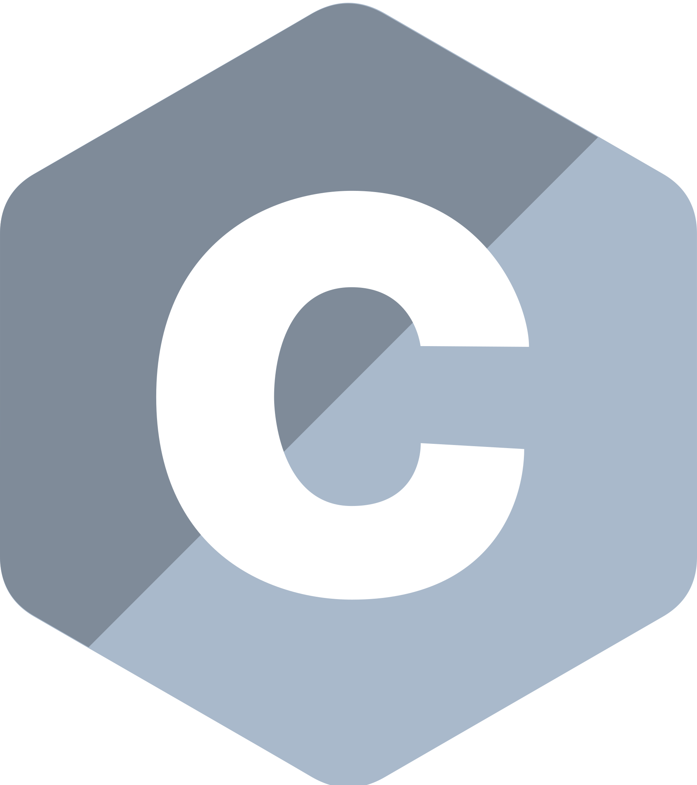
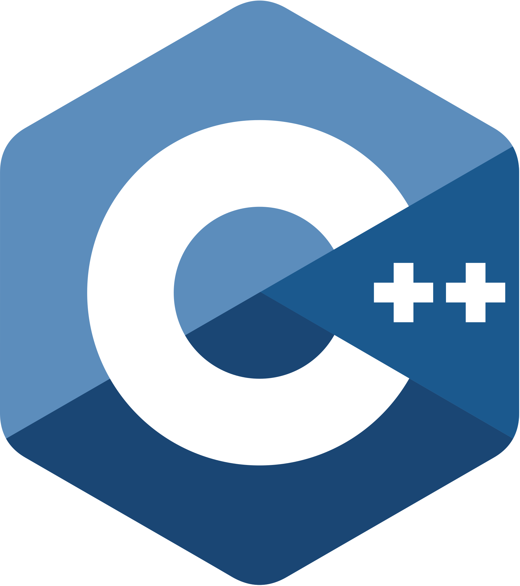
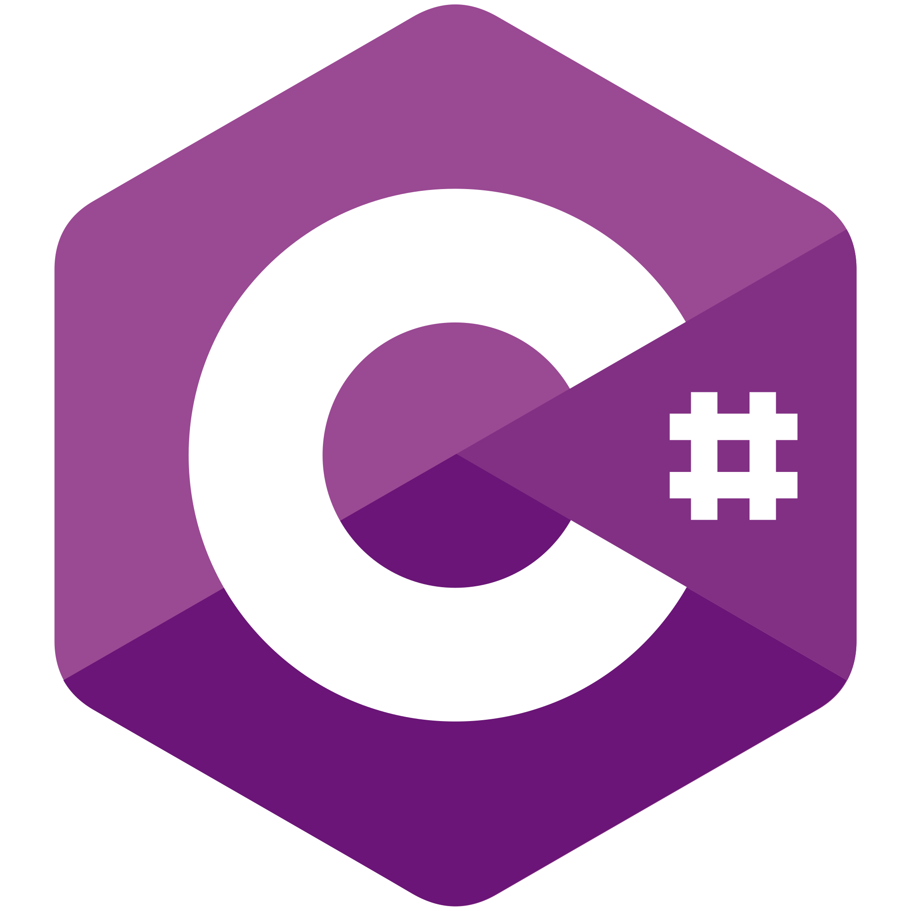
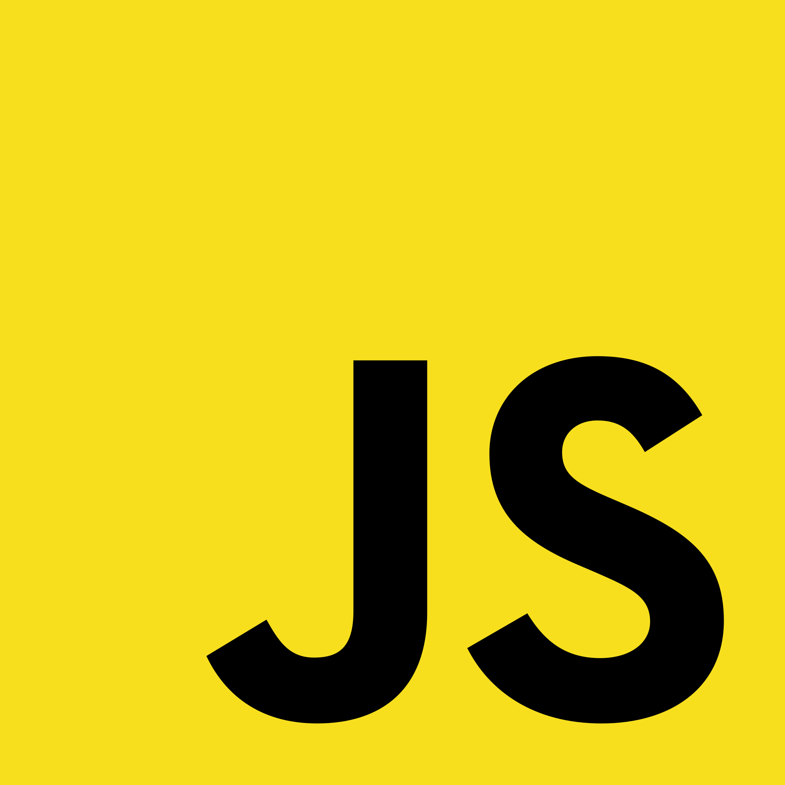
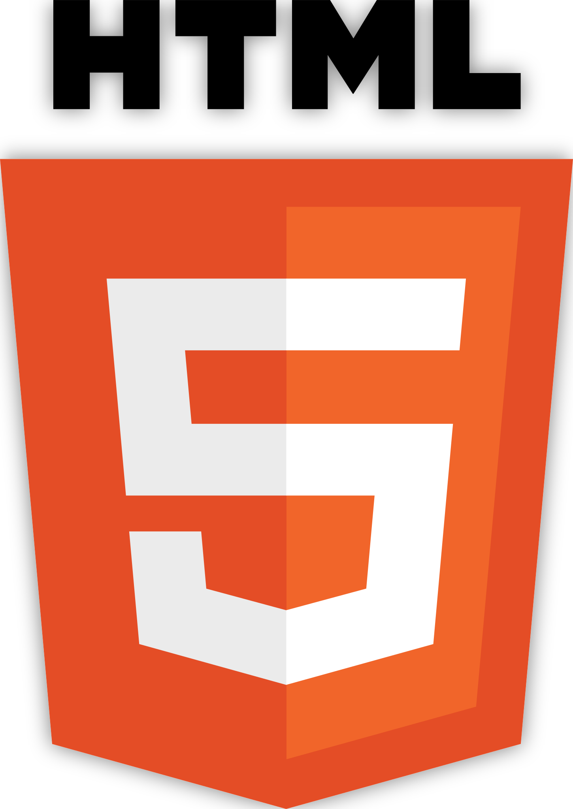
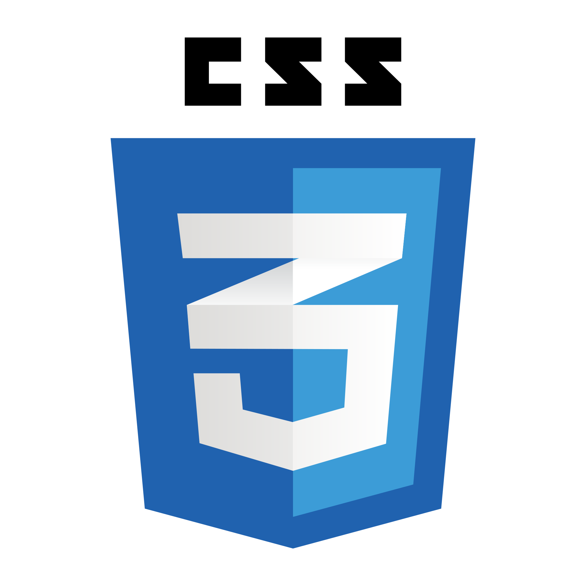
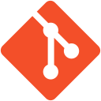
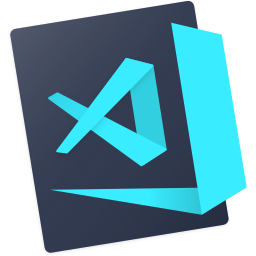
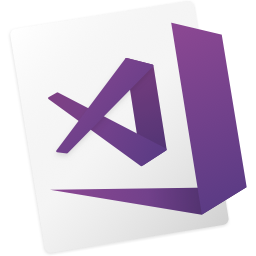
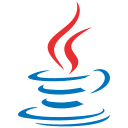

<h1 align="center">
  
</h1>

<h5 align="center">
  <code>
    <a href="https://www.linkedin.com/in/salomaolopes/" title="LinkedIn Profile"> LinkedIn</a></code>
  
</h5>
 

  Bacharel em Ciências da Computação - UFPI /// Licenciado em Matemática - UESPI /// MBA em Data Science e Analytics - USP/ESALQ 
   
   
  🔬 Já trabalhei com Java, JavaScript, Ruby, RubyOnRails, Python, Django...trabalho atualmente com Ciências de Dados, Engenharia de Dados, Docker, Airflow, Kubernetes, configuração de ambiente Databricks, Azure e AWS.  
   
  💬 Se quiser trocar uma idéia sobre programação... <a href="https://github.com/salomaolopes/salomaolopes/issues" title="Issues">Here</a>
   
  📫 Pode mandar email também: <a href="mailto: salomaolopes@protonmail.com">salomaolopes@protonmail.com</a>

<h2 align="center">🔥 Linguagens de Programação / Frameworks / Ferramentas 🔥</h2>
 

  <code></code>
  <code></code>
  <code></code>
  <code></code>
  <code></code>
  <code></code>
  <code></code>
  <code></code>
  <code></code>
  <code></code>
  <code></code>
  <code></code>
  <code></code>
  <code></code>
  <code></code>
  <code></code>
  <code></code>
  <code></code>
  <code></code>

<h2 align="center">⚡ Resultados ⚡</h2>
 

  

    
    
  

           
  

    
  

   
  

<h2 align="center">👨‍💻 Repositórios Públicos 👨‍💻</h2>
 

  

      

<h4 align="center">
  <a href="https://github.com/salomaolopes?tab=repositories" title="Show Repositories">🔎 Show More 🔍</a>
</h4>

<!--
**zumrudu-anka/zumrudu-anka** is a ✨ _special_ ✨ repository because its `README.md` (this file) appears on your GitHub profile.

Here are some ideas to get you started:

- 🔭 I’m currently working on ...
- 🌱 I’m currently learning ...
- 👯 I’m looking to collaborate on ...
- 🤔 I’m looking for help with ...
- 💬 Ask me about ...
- 📫 How to reach me: ...
- 😄 Pronouns: ...
- ⚡ Fun fact: ...

Notes: If you want use this readme, firstly star it please. If you can't align your repositories like this, please change your repository desription to shorter than now. Maybe 4 or 5 word will be good.

-->
